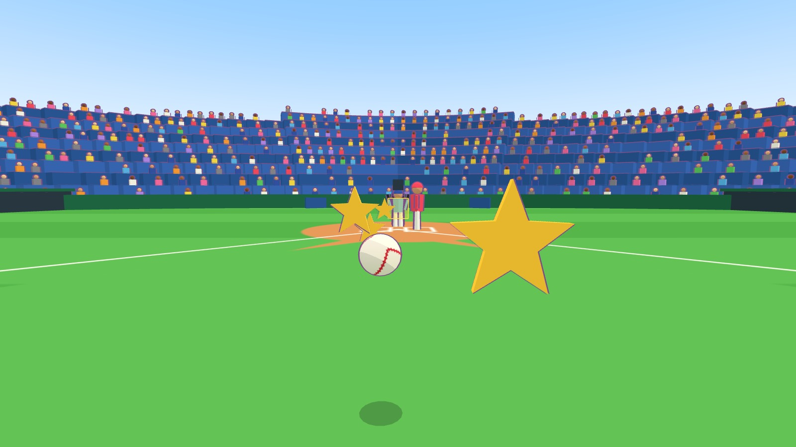
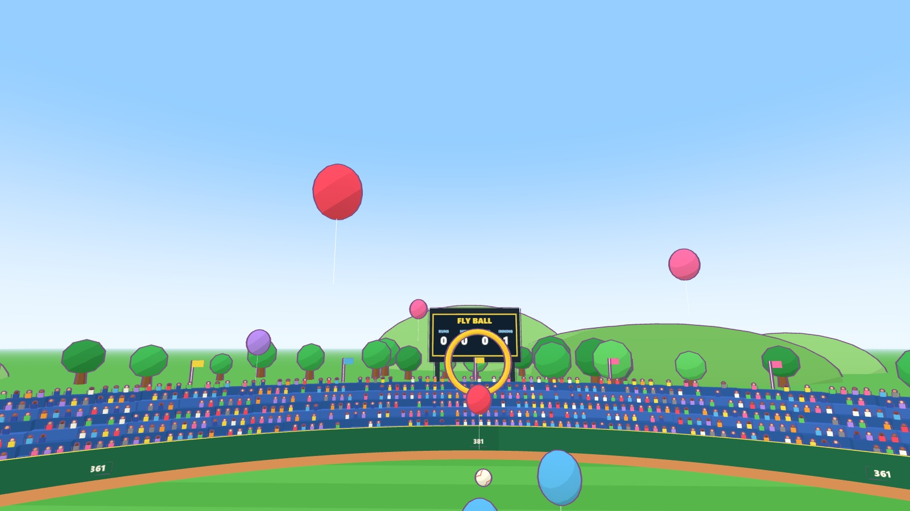

# ⚾ Fly Ball

**Be the baseball.** Ride along behind the ball from the pitcher's hand to the bleachers, and steer it the whole way
by turning your head.

**[Play Fly Ball](https://renegml.github.io/fly-ball/)** (a webcam, a mouse or the arrow keys; nothing to install)

## How to play

1. **The pitch.** The pitcher winds up and throws, and you're riding the ball. Turn your head left, right, up and
   down to fly it through the gold stars on the way to the plate.
2. **The strike zone.** Steer into the glowing box and the batter swings: *CRACK!* Miss the box and it's a ball
   (four balls and the batter walks).
3. **The hit.** Now the ball is flying out over the field in slow motion, and you're still steering. Look **up** to
   carry it over the wall for a home run (and through the gold ring over centre field), **down** for a grounder, and
   **left or right** to aim it, but stay between the foul lines. Pop the balloons on the way!
4. **Watch out for the gloves.** The fielders run for the ball as it comes down, so steer it into the gaps.
5. **Where it lands decides it:** a foul ball, a catch, a ground out, a single, a double, a triple, off the wall, or
   a home run with fireworks. Runners on the bases come home to score runs, and the scoreboard keeps count.

A game is 5, 10, 15 or 20 pitches. At the end you see your runs, hits, home runs, stars and balloons.

## Made for every player

Fly Ball was made for a special education classroom, for students who play with small head movements, a mouse, or a
couple of keys.

- **Steer with your head:** the webcam follows the face of whoever is nearest the middle of the picture. A green ring
  on the camera preview shows who's steering. Everything happens on your own computer: no video is recorded or sent
  anywhere.
- **Or the mouse, or the arrow keys.**
- **Settings to fit each player:** pitch speed, flight speed, how far a small turn steers, **aim help** (the ball
  drifts toward the stars and away from the foul lines by itself), a big strike zone, a calm camera, a dead zone,
  smoothing for shaky movements, and re-centring when a player shifts in their chair.
- **A demo** plays by itself when nobody's there, and hands over as soon as a face is seen.

## In the ballpark

A storybook ballpark in bright colours: striped grass, a dirt infield and chalk lines, a curved outfield wall (315,
361 and 381 ft), yellow foul poles, light towers, dugouts, stands full of fans all the way round, and a scoreboard
beyond centre field. You hear the crowd, the crack of the bat, the pop of the catcher's mitt, cheering, and the
ballpark organ.

## Running it yourself

Everything is in this folder: open `index.html` from any web server (the webcam needs https or localhost).

Built with three.js (MIT) and MediaPipe Face Landmarker (Apache 2.0, in ./mediapipe). The recorded sounds in ./sfx
are CC0 recordings from Freesound (see sfx/CREDITS.txt); the bat, the mitt, the balloons and the organ are made in
the page.
